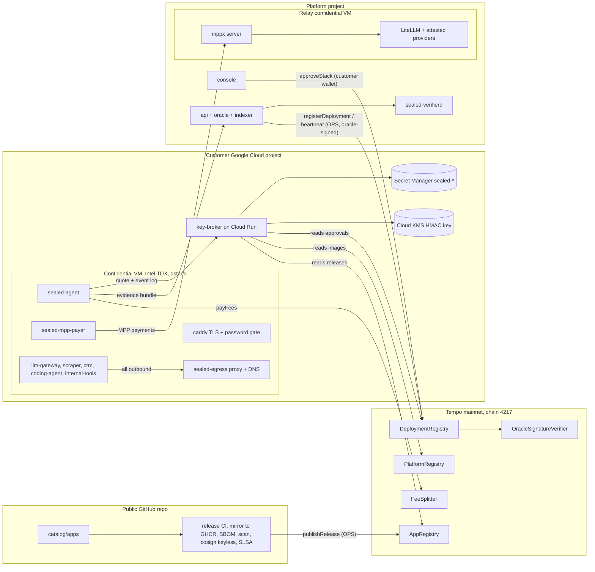

# Sealed architecture

Sealed is a verified open-source app platform. Every app is built from public source, pinned, scanned, signed and reviewed. You can verify that exactly that build is what runs.

Your data stays in your cloud account. Apps run in confidential VMs, we have no access path, and outbound traffic only reaches destinations you approve. Your wallet approves exactly which builds can unlock your data.

Limits: confidential VMs do not stop physical attacks on the server, bugs inside apps, or a cloud provider with physical access.

## Actors

- Operator: runs the control plane (api, console, oracle, indexer), the catalog and its CI, and the inference relay. Owns the contracts.
- Customer: owns a Google Cloud project and a Tempo wallet. Approves stacks onchain, stores secrets in their own Secret Manager, sets spend limits.
- Maintainer: owns an app's packaging in the catalog and receives a share of that app's fees.
- Verifier: anyone holding an evidence bundle and a Tempo RPC endpoint.

## Diagram

## Trust flow

1. A maintainer opens a pull request that adds or bumps an app in `catalog/apps/<id>/`. CI validates the manifest, checks licenses, requires digest-pinned images, builds SBOMs and scans them.
2. On merge, the release job mirrors images to GHCR (same digests), builds a deterministic bundle, signs it with cosign keyless (Rekor entry), adds SLSA provenance, uploads everything to a GitHub Release and calls `AppRegistry.publishRelease` with the OPS key.
3. A customer runs `sealed bootstrap` with their own credentials. It creates the VPC, firewall, Cloud KMS key, the key broker (pinned public image, its own service account) and a deployer service account that the platform may impersonate to create and delete `sealed-*` VMs, disks and IPs only.
4. The customer picks apps in the console. The platform composes the stack deterministically and shows `stackHash` and every release. The customer's wallet calls `DeploymentRegistry.approveStack(stackHash, releaseIds, imageId, expiry)`.
5. The platform creates the confidential VM through the deployer account. dstack boots a measured image and measures the compose hash into RTMR3.
6. sealed-agent asks the customer's key broker for a nonce, produces a TDX quote binding the nonce and an ephemeral key, and sends quote, event log, config and releaseIds. The key broker verifies the quote with Intel collateral, checks the image against PlatformRegistry, replays RTMR3, recomputes the stack from public bundles, and checks the customer's approval onchain. Only then it releases secrets, the disk key and the signer seed, encrypted to the ephemeral key.
7. The agent unlocks the data disk, writes secrets to tmpfs, starts apps, builds an evidence bundle and sends it to the platform oracle. The oracle verifies it independently and submits an oracle-signed record to DeploymentRegistry.
8. Apps send usage events to the agent. Every settlement interval the agent signs a usage report and pays FeeSplitter, which splits each payment between the maintainer and the treasury.
9. Anyone with the evidence bundle runs `sealed verify` against a Tempo RPC to check the whole chain without trusting the platform.

## Components

| component | runs in | language | source |
|---|---|---|---|
| contracts | Tempo mainnet | Solidity, Foundry | `contracts/` |
| catalog and release CI | public GitHub repo | YAML, GitHub Actions | `catalog/`, `.github/workflows/` |
| composer | key broker, CLI, verifierd | Go | `runtime/composer/` |
| sealed-agent | customer VM | TypeScript | `runtime/agent/` |
| sealed-egress | customer VM | Go | `runtime/egress/` |
| caddy config | customer VM | Caddyfile templates | `runtime/caddy/` |
| sealed-mpp-payer | customer VM | TypeScript | `runtime/mpp-payer/` |
| sealed-verifierd | customer VM, platform VM | Go | `verifier/` |
| key-broker | customer project, Cloud Run | Go | `key-broker/` |
| sealed CLI | anywhere | Go | `cli/` |
| inference relay | platform confidential VM | TypeScript, LiteLLM | `runtime/relay/` |
| api, oracle, indexer | platform VM | TypeScript | private repo `services/api/` |
| console | platform VM | Next.js | private repo `console/` |

Formats, hashes and endpoints shared between components are defined in [INTERFACES.md](INTERFACES.md).

## Networks inside a deployment VM

- `apps` (internal: true, 172.30.0.0/24): every app container and sidecar. No route to the internet.
- `edge` (172.31.0.0/24): Caddy's published ports 80 and 443, and sealed-egress.
- sealed-egress is the only container on both networks. It is the HTTP(S) proxy and the DNS server for every container, enforces per-caller allowlists that are part of the measured stack, blocks metadata, link-local and private ranges, and counts allowed and blocked attempts per destination.

## Security properties

| id | property | enforced by |
|---|---|---|
| P1 | Only wallet-approved stacks of active releases on an approved non-debug image receive secrets | key broker checks, DeploymentRegistry, PlatformRegistry, AppRegistry |
| P2 | No shell, no SSH, no serial console login, no cloud service account; apps cannot reach metadata | dstack production image, VM settings, egress deny rules |
| P3 | Apps have no direct internet route; all outbound goes through the measured allowlist | internal Docker network, sealed-egress, firewall rules |
| P4 | The platform's deployer account cannot read secrets, change the key broker or get a shell | custom IAM role with resource-name conditions |
| P5 | Only content-free data leaves the VM toward the platform | agent API surface: health, counts, signed usage totals, evidence |
| P6 | Onchain records hold only hashes and addresses | contract storage layout |
| P7 | Anyone can re-verify a deployment without trusting the platform | `sealed verify` with evidence bundle and Tempo RPC |
