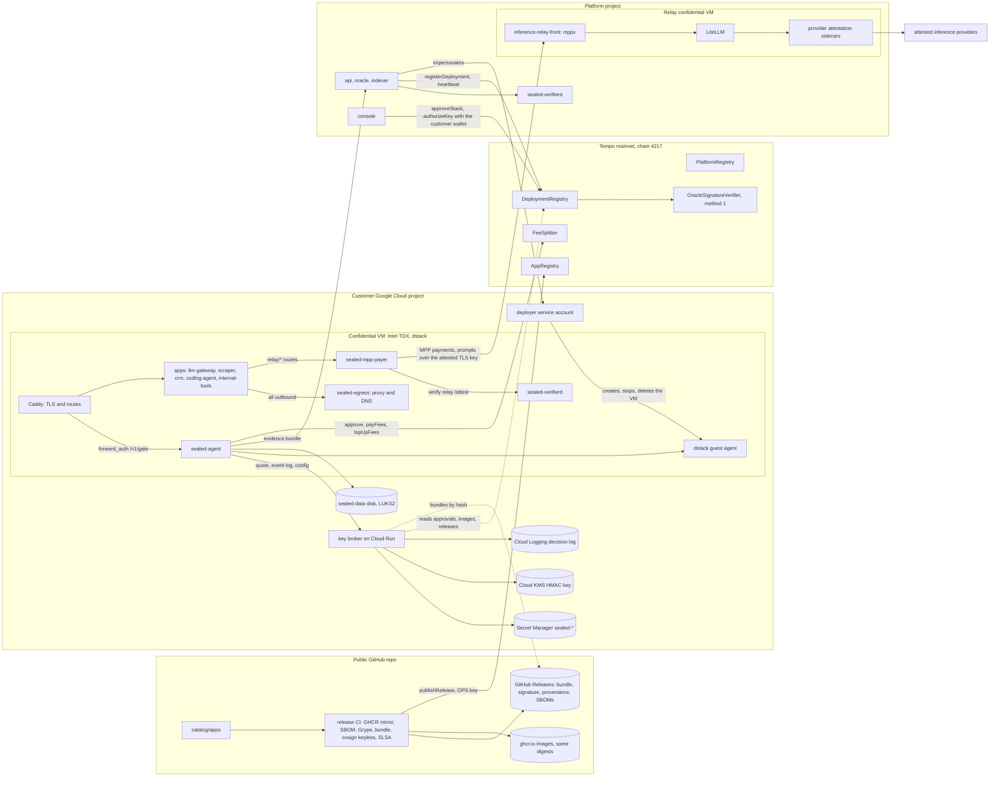
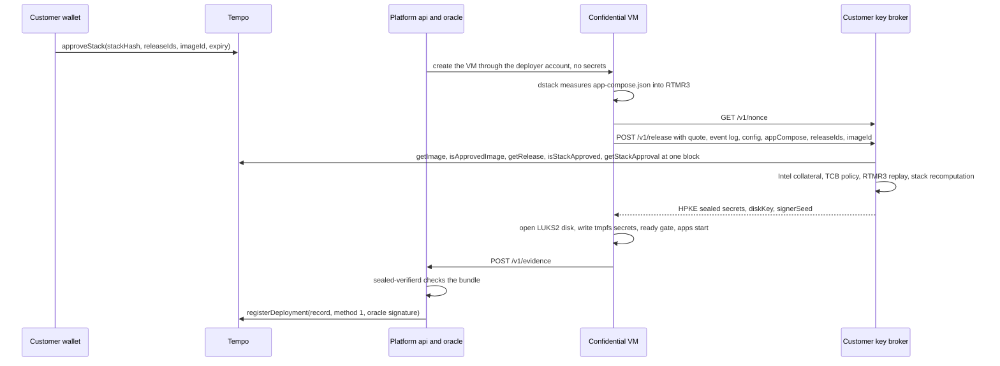
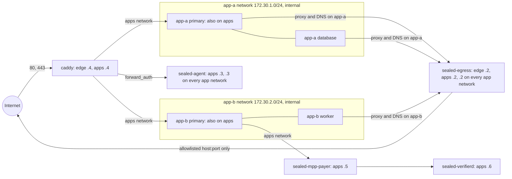

# Sealed architecture

Every app is built from public source, pinned, scanned, signed and reviewed. You can verify that exactly that build is what runs.

Your data stays in your cloud account. Apps run in confidential VMs, we have no access path, and outbound traffic only reaches destinations you approve. Your wallet approves exactly which builds can unlock your data.

Limits: confidential VMs do not stop physical attacks on the server, bugs inside apps, or a cloud provider with physical access.

This document describes the system as built. Byte-level formats are in [INTERFACES.md](INTERFACES.md); the fragment and composed-stack contract is [runtime/composer/README.md](../runtime/composer/README.md), which wins where the two differ (composer 1.2.0, decisions D-040 to D-050). Decisions are cited as D-0xx.

## Actors

- Operator: runs the control plane (api, oracle, indexer, console), the catalog and its release CI, and the inference relay. Owns the contracts (OWNER key, `Ownable2Step`), holds the OPS key (release registrar, record submitter) and the ORACLE key (signs deployment records; it exists only in the platform's Secret Manager).
- Customer: owns a Google Cloud project and a Tempo wallet. Runs the bootstrap with their own credentials, keeps secrets in their own Secret Manager, approves stacks onchain, authorizes a daily spend limit.
- Maintainer: owns an app's packaging in the catalog and receives a share of that app's fees in USDC.e.
- Verifier: anyone holding an evidence bundle and a Tempo RPC endpoint.

## System overview

Not drawn: every outbound connection of the agent, Caddy, the payer and verifierd also goes through sealed-egress (key broker, platform api, Tempo RPC, Intel PCS, Let's Encrypt, the relay). Image pulls by dockerd are digest-pinned and do not go through it. The key broker, `sealed verify` and the oracle's verifierd fetch release bundles from GitHub Releases and accept them only when their sha256 equals the onchain bundleHash.

## Components

| component | runs in | language | source |
|---|---|---|---|
| contracts | Tempo mainnet | Solidity, Foundry | `contracts/` |
| catalog and release CI | public GitHub repo | YAML, GitHub Actions, Go | `catalog/`, `catalog/tools/`, `.github/workflows/` |
| composer | key broker, CLI, verifierd, release CI | Go | `runtime/composer/` |
| sealed-agent | customer VM | TypeScript | `runtime/agent/`, `packages/core/` |
| sealed-egress | customer VM | Go (stripe/smokescreen as a library) | `runtime/egress/` |
| Caddy config and gate template | customer VM | Caddyfile, Go | `runtime/caddy/` |
| envexec | every app container | Go | `runtime/envexec/` |
| sealed-mpp-payer | customer VM, only with llm-gateway | TypeScript | `runtime/mpp-payer/` |
| sealed-verifierd | customer VM (for the payer), platform VM (for the oracle) | Go | `verifier/` |
| key broker | customer project, Cloud Run | Go | `key-broker/` |
| sealed CLI | anywhere | Go | `cli/` |
| customer bootstrap | customer project | Terraform | `infra/terraform/customer-bootstrap/` |
| inference relay | platform confidential VM | TypeScript, LiteLLM | `runtime/relay/`, `catalog/apps/inference-relay/` |
| api, oracle, indexer | platform VM | TypeScript | private repository |
| console | platform VM | Next.js | private repository |

## Trust flow

1. A maintainer opens a pull request that adds or bumps `catalog/apps/<id>/`. CI validates the manifest against the schema, runs the composer lint (licenses D-021 and D-050, digests, telemetry switches, egress policy, exclusions, waivers), builds SBOMs with Syft and scans them with Grype, and composes every app with `docker compose config`.
2. On merge, the release job mirrors the images to GHCR with identical digests, builds the deterministic bundle tar, signs it with cosign keyless through GitHub OIDC (logged in Rekor), adds SLSA provenance, uploads everything to a GitHub Release under the D-046 asset rule, and calls `AppRegistry.publishRelease` with the OPS key.
3. A customer runs `sealed bootstrap` with their own credentials. The key broker is deployed from a digest-pinned public image with its own service account, and its customer address and Tempo RPC are set by the customer.
4. The customer picks apps. The composer builds `app-compose.json` deterministically from the public config and the release bundles; its sha256 is the stackHash. The customer's wallet calls `DeploymentRegistry.approveStack(stackHash, releaseIds, imageId, expiry)`. The first approval of a stackHash fixes its release list and image (contract review CR-2).
5. The platform creates the VM through the deployer account (or the customer does, with `sealed deploy`). dstack boots the measured image and measures the compose hash into RTMR3.
6. sealed-agent gets a nonce from the customer's key broker and a TDX quote whose report_data binds that nonce and an ephemeral X25519 key. The key broker verifies the quote with Intel collateral and its TCB policy, checks the measurements against an approved non-debug image in PlatformRegistry, replays RTMR3, recomputes the stack byte for byte from the onchain releases and their bundles, and checks the customer's approval and its exact release set (D-014). Only then it returns the stack's secrets, the data-disk key and the signer seed, HPKE-encrypted to the ephemeral key. Every decision goes to the customer's Cloud Logging.
7. The agent unlocks the data disk, writes each declared secret to tmpfs, opens the ready gate, starts the apps, and sends an evidence bundle to the platform oracle. The oracle verifies it independently with sealed-verifierd, signs an EIP-712 record and submits `registerDeployment` with the OPS key. Re-attestation every 24 hours and after a reboot gives a `heartbeat`.
8. Apps send usage events to the agent. Every settlement interval the agent signs a usage report and pays FeeSplitter, which splits each payment between the maintainer and the treasury.
9. Anyone with the evidence bundle runs `sealed verify` against a Tempo RPC to check the whole chain without trusting the platform ([VERIFY.md](VERIFY.md)).

The oracle is not in the secret-release path. Secrets move only on the key broker's own checks in the customer's project.

## Boot and key release

`diskKey` and `signerSeed` are HMAC-SHA256 values computed by Cloud KMS over a tag and the deploymentId (D-011), so a reboot of the same deployment gets the same disk key and the same enclave signer, and the root key never leaves KMS. The enclave signer is derived from the seed with HKDF inside the VM.

## Networks inside a deployment VM (D-041)

| network | subnet | members |
|---|---|---|
| `apps` | `172.30.0.0/24`, internal | sidecars (egress `.2`, agent `.3`, Caddy `.4`, payer `.5`, verifierd `.6`) and each app's primary service (from `.16`, alias `<appId>`) |
| `edge` | `172.31.0.0/24`, inter-container traffic off | sealed-egress `.2` and Caddy `.4` (publishes 80 and 443) |
| `app-<appId>` | `172.30.<n>.0/24`, internal, n = 1..16 in sorted app order | every service of that app, sealed-egress `.2`, sealed-agent `.3` |

- A non-primary service (a database, a worker, a bootstrap job) is reachable only from its own app, sealed-egress and sealed-agent. Apps reach each other only primary to primary on `apps`, for example coding-agent to `llm-gateway`, and llm-gateway to `sealed-mpp-payer`.
- Every service's `dns` and `HTTP(S)_PROXY` point at sealed-egress on its own app network. sealed-egress identifies callers by source address (one caller per address) and enforces per-caller allowlists that are part of the measured stack: the agent may reach only the key broker, the platform api and the Tempo RPC; Caddy only Let's Encrypt ACME; the payer only the relay and the Tempo RPC; verifierd only Intel PCS, the Tempo RPC and the relay attest host (the release asset hosts it needs for stack recomputation are an open item, see [THREAT_MODEL.md](THREAT_MODEL.md#open-items-before-production)); an app service only its manifest's `default_allow` plus the customer's `egressAdditions`.
- sealed-egress resolves only allowlisted names (everything else is NXDOMAIN and counted), never dials metadata, link-local, loopback or the VM's own networks, dials private ranges only inside the config's `allowedVpcRanges`, and checks every resolved address again just before the dial. Counts per allowlist entry, with a fixed vocabulary for everything else, are the only egress data that leaves the VM.
- Capabilities: app services drop `NET_RAW` (so they cannot spoof a source address), `AUDIT_WRITE`, `MKNOD` and `SETFCAP`; every service has `no-new-privileges`; sidecars drop `ALL` except what each needs. Proxy credentials (`proxyAuth`) exist in sealed-egress but stay off: identity is the source address on separate networks with `NET_RAW` dropped.
- Host rules (`pre_launch_script`, measured) drop anything forwarded from the edge subnet to outside the VM unless it comes from sealed-egress, and fail closed when they cannot be verified.
- Bootstrap firewall rules: ingress TCP 80 and 443 to tagged Sealed VMs only; egress TCP 443 and 53 only, then deny all.

## Ingress and the password gate (D-044, D-045)

Caddy terminates TLS inside the VM with keys generated there. Hostnames are `<route>.<ip-with-dashes>.sslip.io` or customer domains. Routes: `gateway`, `scraper`, `crm`, `code`, `tools`, and `attest`.

- `gate` routes: Caddy runs `forward_auth sealed-agent:7070` with `uri /v1/gate?route=<route>`. The agent answers 200 for a valid `sealed_gate` cookie (HMAC-SHA256 with a per-boot key, 12 hours, `HttpOnly; Secure; SameSite=Lax`) or for Basic auth as user `sealed` whose password matches the bcrypt hash released by the key broker; a Basic success sets the cookie (a 303 for browser navigations). Otherwise 401 with a Basic challenge, 429 under brute force, and 503 `starting` until the app's bootstrap job has finished, so no app is reachable half configured.
- Caddy strips the gate's own Basic credentials and the `sealed_gate` cookie before proxying, so an app's own `Authorization` header (for example a Bearer token) passes untouched and no app can replay the gate cookie.
- `bearer-passthrough` (only llm-gateway `gateway`): LiteLLM bearer keys go straight to the gateway; anything else on that route is gated.
- `public`: only `attest` and the relay's `relay` route. A manifest cannot turn the gate off for any other route; the composer rejects it.
- `attest` proxies `sealed-agent:7070/attest`, which returns a fresh quote over `sha256("sealed/attest/v1" || nonce || tlsPubKeyHash || enclaveSigner)`, so a caller learns that the TLS key it is talking to belongs to the attested VM.
- The relay route sets `on_attest_host: true`: the relay's `/v1` API is served on its attest host, the same origin and certificate as `/attest` (D-045).
- The payment-needed switch: the agent loads the measured `Caddyfile.payment-needed` through Caddy's admin socket (group 10001, mode 0660, on a tmpfs). App hosts then answer 402 with a static page; `/attest` and the data are untouched.

## Secrets inside the VM (D-042, D-043)

- The key broker returns only the secrets named in the manifests of the stack's releases, plus the gate's bcrypt hash. Secret Manager names are `sealed-<app>-<NAME>` and `sealed-gate-password`.
- `same_as: "<appId>/<NAME>"` lets one app use another app's secret (for example a gateway key). The referenced app must be in the stack; the broker returns the value under the referencing app's name.
- The agent writes each secret file to the host's `/run` tmpfs. Each service gets read-only bind mounts of exactly the files it lists in `x-sealed-secrets`, never a directory. The agent refuses to boot if the measured compose would let a service see another owner's secrets.
- envexec waits for `/run/sealed/ready/ok`, exports only the declared names, and execs the app. Caddy holds no secret.

## Data at rest (D-017)

- dstack's own system disk uses `key_provider: tpm`: its seed is sealed in the Google Cloud vTPM. It holds container images and container layers.
- App data lives on a separate persistent disk, `sealed-data`, which survives the VM. sealed-agent formats and opens it with LUKS2 (aes-xts-plain64, 512-bit) using keys derived from the broker's `diskKey`, and checks the header and the device-mapper table before mounting, so a header the host prepared can never be mounted. Every app volume, Caddy's certificate store and the agent's state are directories on it.
- The agent is the only container with the dstack socket, the data-disk device and `CAP_SYS_ADMIN`. The composer rejects privileged mode, devices, host networking, extra capabilities, bind mounts and any socket mount in app fragments.

## Payments

All amounts are FEE_TOKEN base units: USDC.e, 6 decimals (D-035). Prices come from `config/defaults.yaml`: $0.20 per 1M gateway tokens, $0.20 per 1,000 scraped pages, $0.05 per app-hour for crm, coding-agent and internal-tools, and relay inference at provider list price plus 5%.

1. Metering. llm-gateway posts token counts from a LiteLLM callback, the scraper posts successful page counts, and the agent counts app-hours of heartbeat apps from container health. Only counts and model names reach the agent; prompts and outputs never leave the gateway.
2. Usage reports. Each settlement interval (60 minutes, 5 in tests) the agent closes a period and signs an EIP-712 `UsageReport` with the enclave signer. Its digest is the `usageHash`. The report goes to the platform api.
3. Spending. The customer's wallet authorizes the enclave signer as a Tempo access key on the customer account (`AccountKeychain.authorizeKey`) with a daily limit ($2 by default) and allowed calls limited to `approve` of the fee token to FeeSplitter, `payFees` and `topUpFees` (D-026, D-034). FeeSplitter sees the customer as `msg.sender`. The fallback mode pays from the enclave signer's own balance.
4. Settlement. One Tempo transaction per batch: `approve(FeeSplitter, exact total)`, one `payFees` per leg, and `topUpFees` for any leg someone paid short, ending with the allowance back at zero. A leg counts as paid only when `usagePaid(deploymentId, usageHash, appId)` reaches the report's fee (contract review V-1). FeeSplitter enforces $5 per payment and $20 per deployment per UTC day, credits 20% (`maintainerShareBps` 2000) to the app's maintainer and the rest to the treasury, and both withdraw with `withdraw(token)`.
5. Failure. Billing fails closed. When payments keep failing for the grace period (24 hours, 5 minutes in tests), the agent switches app routes to the payment-needed page; data stays intact, and the routes come back after the next successful settlement.

## The inference relay (D-045, D-048)

- The relay is an ordinary Sealed stack (`inference-relay`) in a confidential VM in the platform project, with its own key broker. OWNER is the customer that approves its stack, and it has its own onchain record.
- Services: `inference-relay-front` (mppx server, Tempo payment method, payee the treasury `0x755a1e289503c7109d01a74ed253ba0f724ca3eb`, currency USDC.e), its Postgres session store, LiteLLM holding the platform's provider keys, and one verification sidecar per attested provider (Tinfoil, Phala, NEAR AI, Privatemode). A provider is used only while its own attestation verifies; otherwise the relay answers `503 attestation_failed` before any payment.
- Customer side: llm-gateway routes `relay/<model>` to sealed-mpp-payer. Before first use and every 15 minutes the payer fetches the relay's `/attest` with a fresh nonce and has the in-VM sealed-verifierd check it: quote, image, a stack approved by OWNER, active releases, and the relay app only. Prompts and payments then go only over TLS connections that present the attested key.
- Payment: MPP sessions over the TIP-1034 escrow with per-token charging, falling back to per-request charges priced from prompt tokens plus `max_tokens`.
- Shared budget (D-048): fee settlement and the payer draw on one daily budget equal to the access-key limit. The payer reserves through `POST /v1/spend/reserve` and releases through `/v1/spend/release`; it may use at most the limit minus fees spent, payer spend, open reservations and the next settlement's estimated fees. Fee settlement is never blocked by the payer. No reservation, no payment.

## Determinism and versions

- Canonical JSON (sorted ASCII keys, integers only, no insignificant whitespace) has one Go implementation (`runtime/composer/cjson`) and a TypeScript twin in `@sealed/core`, both tested on shared vectors.
- The composer exists once, in Go (D-006); the key broker, `sealed verify`, verifierd and release CI all use it. Any change to composed bytes needs a new composer version, because approved stacks pin the old bytes. The config names its `composerVersion`, and a composer refuses any other.
- Images are referenced only by digest from the catalog registry `ghcr.io/sealedtempo`. Release bundles are deterministic ustar archives, so `sealed release build <app>` reproduces a published bundleHash.

## Contracts

| contract | job |
|---|---|
| PlatformRegistry | measured OS images: MRTD and RTMR0 to RTMR2 hashed onchain, debug flag, Active, Deprecated or Revoked |
| AppRegistry | apps (owner) and releases (registrar role): bundleHash, egressPolicyHash, sbomHash, provenance and signature URIs |
| DeploymentRegistry | stack approvals by customers, attested deployment records, heartbeats, close; one pluggable verifier per attestation method |
| OracleSignatureVerifier | method 1: an allowed oracle signer's signature over the EIP-712 record digest |
| FeeSplitter | per-app fee payments from a deployment's customer or enclave signer, caps, maintainer and treasury credits, pull withdrawals |

All five are non-upgradeable and store only hashes and addresses for deployments (P6). Addresses are in the [README](../README.md#contracts-on-tempo-mainnet) and `contracts/deployments/tempo-mainnet.json`.

## Security properties

| id | property | enforced by |
|---|---|---|
| P1 | Only stacks the customer's wallet approved onchain, built only from active releases, on an approved non-debug image, receive the customer's secrets | key broker checks; DeploymentRegistry, PlatformRegistry, AppRegistry |
| P2 | Production VMs have no shell, no SSH daemon, no serial console login and no cloud service account; app containers cannot reach the metadata server | dstack production image; VM settings; egress deny rules |
| P3 | App containers have no direct internet route; all outbound goes through the measured allowlist, with allowed and blocked counts per destination | internal Docker networks; sealed-egress; host rules; firewall |
| P4 | The platform's deployer account can create, stop and delete VMs, but cannot read secrets, change the key broker or get a shell | custom IAM roles with resource-name conditions; IAM checks |
| P5 | Only content-free data leaves the VM toward the platform: health, counts, signed usage totals, attestation evidence | agent API surface; egress stats vocabulary |
| P6 | Onchain records hold only hashes and addresses | contract storage layout |
| P7 | Anyone can re-verify a deployment without trusting the platform | `sealed verify` with an evidence bundle and a Tempo RPC |

How each property can fail, and what is not covered, is in [THREAT_MODEL.md](THREAT_MODEL.md).
